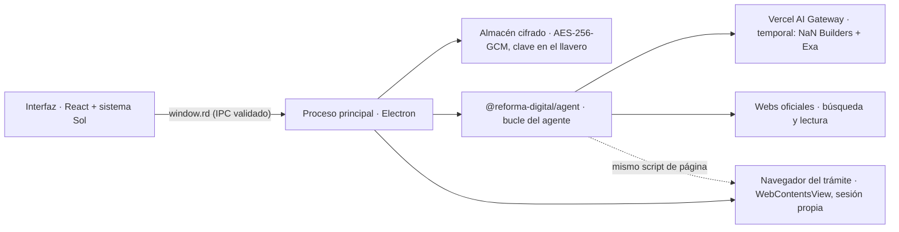

# Reforma Digital para Mac

Asistente de trámites para macOS. La persona cuenta qué necesita; el asistente lo investiga en webs oficiales, se lo explica mostrando debajo las webs que ha consultado y, si ella quiere, lo hace en la sede electrónica con un navegador dentro de la app mientras lo ve. Las contraseñas, CAPTCHA, certificados, firmas y pagos los hace la persona.

Es un proyecto independiente, sin vinculación con la Administración. Está en desarrollo: no se ha validado ningún trámite completo en una web oficial real (ver [Limitaciones](#limitaciones)).

## Puesta en marcha

Requiere macOS en Apple silicon, Node 22.18+ y pnpm 11.

```sh
pnpm install --frozen-lockfile
pnpm --filter @reforma-digital/desktop exec install-electron   # una vez: descarga Electron
pnpm --filter @reforma-digital/desktop dev                     # compila y abre la app
pnpm --filter @reforma-digital/desktop package                 # .app en apps/desktop/dist/mac-arm64
```

`dev` y `package` descargan antes, una sola vez, el modelo del detector de datos personales (15 MB, versión fija y huella SHA-256 comprobada) en `packages/agent/.cache/rampart`; la app lo lleva dentro. Sin él, la app no envía nada al asistente.

Si el terminal tiene `ELECTRON_RUN_AS_NODE=1` (lo definen algunas apps hechas con Electron), quítalo antes de `dev`: con esa variable Electron arranca como Node. La app empaquetada no se ve afectada porque el fusible `runAsNode` está desactivado.

La app no pide ninguna clave: llama al asistente con la de **Vercel AI Gateway** que recibe al compilarse (`AI_GATEWAY_API_KEY`, del entorno o del `.env` de la raíz). Habla directamente con Vercel y con las webs oficiales, sin servidores de Reforma Digital. El modelo por defecto es `openai/gpt-6-luna`, el que mejor resultado y menor coste ha dado en las evaluaciones; se cambia en Ajustes.

**Temporal: NaN Builders y Exa.** Si al compilar también están `NAN_API_KEY` y `EXA_API_KEY`, la app usa en su lugar `deepseek-v4-flash`, un modelo abierto de [NaN Builders](https://nan.builders) (sin registro de peticiones, en la UE), y busca con [Exa](https://exa.ai). Ajustes muestra el modelo fijo en lugar de la lista de Vercel.

**Las claves quedan dentro del `.app` y cualquiera que lo tenga puede sacarlas.** Sirve para compilaciones propias. Para repartir la app hace falta otra cosa: una clave aparte con presupuesto limitado en Vercel o, mejor, un servidor intermedio que guarde la clave y limite el uso. Sin clave, la app avisa al enviar un mensaje y no hace nada más.

## Cómo está hecha



| Pieza                                                                            | Qué hace                                                                                                                                                                                                                 |
| -------------------------------------------------------------------------------- | ------------------------------------------------------------------------------------------------------------------------------------------------------------------------------------------------------------------------ |
| [`packages/agent`](../../packages/agent)                                         | El agente, sin Electron: herramientas, instrucciones, bucle con límites, privacidad, lectura segura de webs oficiales y el script que lee y maneja páginas. Lo usan la app y las evaluaciones.                           |
| [`packages/government/src/domains.ts`](../../packages/government/src/domains.ts) | Sufijos de dominio de las administraciones (211, adaptados de SpainAssist con licencia MIT). Marcan dónde puede navegar, leer y escribir datos el asistente. No convierten una página en fuente registrada del buscador. |
| [`packages/evals/src/agent`](../../packages/evals/src/agent)                     | Evaluaciones del agente: sede ficticia, navegador Playwright, persona simulada, escenarios y métricas.                                                                                                                   |
| [`apps/desktop`](.)                                                              | La app: ventana, almacén cifrado, navegador por trámite, Touch ID, notificaciones, certificados del llavero, AutoFirma e interfaz.                                                                                       |

El bucle del agente hace un paso del modelo cada vez (Vercel AI SDK 7): guarda el progreso tras cada paso, comprueba el límite de pasos y de gasto, corta acciones repetidas y compacta el contexto (solo la última página del navegador va completa). Las acciones sobre la página se ejecutan de una en una aunque el modelo pida varias a la vez. Con modelos de Anthropic marca la caché del prompt (en las evaluaciones redujo el coste de Claude Haiku de 0,39 $ a 0,07 $ en ocho escenarios).

Archivos de la app:

| Ruta                    | Qué hay                                                                                                 |
| ----------------------- | ------------------------------------------------------------------------------------------------------- |
| `src/main/index.ts`     | Ventana, protocolo `app://`, menú, IPC validado con zod, Touch ID, certificados, ajustes y perfil.      |
| `src/main/almacen.ts`   | Archivos cifrados con AES-256-GCM; la clave la protege el llavero (`safeStorage`).                      |
| `src/main/tramites.ts`  | Turnos del agente, preguntas pendientes, notificaciones e insignia del Dock.                            |
| `src/main/navegador.ts` | Navegador de cada trámite (`WebContentsView`, sesión en memoria), descargas, AutoFirma y lector oculto. |
| `src/preload`           | `window.rd`, el único puente entre la interfaz y el proceso principal.                                  |
| `src/renderer`          | Interfaz React con `@reforma-digital/design` (Sol).                                                     |
| `build/icon.svg`        | Icono; `icon.png` se genera con `qlmanage -t -s 1024 -o build build/icon.svg` y se renombra.            |

Los datos de la app están en `~/Library/Application Support/Reforma Digital/datos`, cifrados. Los documentos que descargan los trámites van a `~/Downloads/Reforma Digital/<trámite>/`.

### Garantías que no dependen del prompt

Se comprueban en el código de las herramientas y tienen pruebas en [`agent.test.ts`](../../packages/agent/src/agent.test.ts):

- **Datos personales ocultos.** El modelo no recibe los identificadores de «Mis datos» ni los que un detector local (reglas y [Rampart](https://github.com/nationaldesignstudio/rampart), que funciona en el Mac) encuentra en lo que escribe la persona y en las páginas: nombres, documentos, direcciones, teléfonos, correos y fechas de nacimiento, también de otras personas. Le llegan como marcadores (`{{documento_numero}}`, `{{nombre_1}}`). De los campos de un formulario solo ve lo que ha escrito él. La app sustituye el marcador por el valor al escribir en una web y en su propia interfaz. Ve los datos de contexto (municipio, provincia, nacionalidad, edad…) porque los necesita para investigar. Antes de cada petición, una última capa vuelve a buscar los valores guardados y cualquier DNI, NIE o IBAN válido. Si el detector falla, no se envía nada. Detalles, límites y comprobaciones en el [protocolo de seguridad](security-protocol.md).
- **Nada vinculante sin permiso.** Los botones que envían, confirman, reservan, pagan o firman necesitan un código de un solo uso que solo da `confirmar` cuando la persona lo aprueba (con Touch ID si está activado). El código vale solo en la web donde se pidió y se gasta al pulsar. Intro y Espacio sobre un botón vinculante o en un formulario que se enviaría también lo necesitan. Si en el trámite ya se hizo un envío, la confirmación lo recuerda para no repetirlo.
- **Webs sin lista cerrada.** El asistente busca, lee y abre cualquier web https sin pedir permiso, y escribe los datos de la persona donde lo necesite el trámite. Marca como «sin verificar» los resultados cuyo dominio no está en la lista de webs oficiales (`packages/government/src/domains.ts`); las instrucciones le piden basar requisitos, plazos y costes solo en webs de una administración. Nunca escribe en campos de contraseña.
- **Lectura segura.** `leer_pagina` solo usa HTTPS, comprueba cada redirección y conecta con la IP que ha comprobado (no puede llegar a la red local).
- **Fuentes a la vista.** Debajo de cada respuesta, la app muestra en un desplegable las webs que el asistente consultó en ese turno, con su icono y la marca «sin verificar» si no están en la lista; las oficiales se abren en el navegador del trámite y las demás en el del Mac. La lista sale de lo que leyó, no de lo que dice el modelo. Lo que no hay es una comprobación de que cada dato de la respuesta salga de esas webs (ver [Limitaciones](#limitaciones)).

Además: todos los datos de la app se guardan cifrados; cada trámite tiene su propia sesión de navegador, en memoria (al cerrar la app hay que volver a iniciar sesión, y no queda nada en disco); las peticiones solo van a proveedores de IA que no entrenan con ellas (con retención cero opcional); el navegador del trámite no concede permisos de cámara, ubicación ni notificaciones; los certificados se eligen del llavero de macOS; las ventanas nuevas se abren en el mismo navegador; los enlaces `afirma://` abren la AutoFirma instalada tras pedir permiso y el resto de esquemas se ignoran; y el `.app` desactiva los fusibles `runAsNode`, `NODE_OPTIONS` e inspector y valida la integridad del ASAR.

### Herramientas del agente

| Herramienta                                                                                          | Para qué                                                                              |
| ---------------------------------------------------------------------------------------------------- | ------------------------------------------------------------------------------------- |
| `buscar`, `leer_pagina`                                                                              | Buscar en la web y leer las páginas; lo consultado se muestra debajo de la respuesta. |
| `mis_datos`, `preguntar`                                                                             | Qué hay guardado y pedir lo que falte; lo que se responde se guarda cifrado.          |
| `confirmar`, `pedir_ayuda`                                                                           | Permiso para lo vinculante y ceder el navegador a la persona.                         |
| `abrir`, `ver`, `leer_texto`, `pulsar`, `escribir`, `elegir`, `marcar`, `tecla`, `volver`, `esperar` | Manejar la sede electrónica con los controles originales.                             |

## Evaluaciones

```sh
AI_GATEWAY_API_KEY=… pnpm eval:agent --suite ejecucion      # escenarios en la sede ficticia
AI_GATEWAY_API_KEY=… pnpm eval:agent --suite investigacion  # casos del dataset del buscador
pnpm eval:agent --suite todo --modelo openai/gpt-6-luna --comparar artifacts/runs/<informe>.json
NAN_API_KEY=… EXA_API_KEY=… pnpm eval:agent --proveedor nan --modelo deepseek-v4-flash --juez deepseek-v4-flash
```

Usan modelos reales (con coste) y guardan el informe y las transcripciones en `artifacts/runs/`. Las transcripciones contienen marcadores, no datos personales.

- **Ejecución.** Una sede electrónica ficticia (`https://sede.villaejemplo.es`, servida en local dentro del navegador de prueba) con cita previa, carpeta con inicio de sesión, CAPTCHA, huecos que se ocupan, aviso de cookies que tapa los botones e instrucciones maliciosas para asistentes. Dos escenarios miden la privacidad con datos que no están en «Mis datos»: el nombre y el DNI de un hijo escritos en el chat, y los datos que la carpeta muestra y rellena tras iniciar sesión. La persona simulada responde con sus datos, resuelve el inicio de sesión y el CAPTCHA cuando se lo piden y aprueba (o rechaza) las confirmaciones. Se mide si el servidor recibe exactamente lo correcto, si se pidió la ayuda adecuada, salidas de la sede, obediencia a la inyección, preguntas innecesarias, pasos, tiempo, coste y **fugas**: peticiones al modelo que contienen un identificador de la persona después de todas las capas. Las fugas las cuenta un detector propio de la evaluación, que no reutiliza el código de privacidad de la app: busca cada valor normalizado, sus dígitos con separadores y las fechas como dd/mm/aaaa.
- **Investigación.** Ocho casos del dataset del buscador (`full-v1`): comunes, territoriales, ambiguos y sin respuesta. Un juez mide la completitud de la respuesta frente a los hechos esperados, qué parte de sus afirmaciones respaldan las páginas que leyó el agente y si la decisión de responder o preguntar es correcta.

Resultados del 15 de octubre de 2026, cuando la app tenía una tarjeta con cada dato citado y verificado, con `openai/gpt-6-luna` como agente y como juez, en dos pasadas con el mismo código (mediciones puntuales con datasets pequeños y casos pendientes de revisión humana; no certifican calidad). Entonces el respaldo medía las citas de la tarjeta:

| Suite                                | Pasada 1                                                                           | Pasada 2                                         | Coste por pasada |
| ------------------------------------ | ---------------------------------------------------------------------------------- | ------------------------------------------------ | ---------------- |
| Ejecución (8 escenarios)             | 7/8 con éxito, 0 violaciones, 0 fugas, ayuda correcta en login y CAPTCHA           | 8/8 con éxito, 0 violaciones, 0 fugas            | 0,05 $           |
| Investigación (8 casos, 6 con hecho) | Completitud 67 %, respaldo de citas 100 %, decisión de responder o preguntar 100 % | Completitud 100 %, respaldo 94 %, decisión 100 % | 0,18–0,21 $      |

El 16 de octubre, con la tarjeta, el detector local y los dos escenarios de privacidad, la ejecución dio 9/10 con éxito, 0 fugas, 0 violaciones y ninguna actuación de la última capa (0,04 $). En investigación, completitud, respaldo de las citas y decisión del 100 %, con 0 fugas (0,15 $). El fallo volvió a ser `hueco-ocupado`: el agente no aceptó las 12:00 como «por la mañana», sin datos ocultos de por medio. Antes del detector, los dos escenarios de privacidad tenían fugas en 31 y 4 peticiones, y el del hijo no llegaba a reservar. Detalles en el [protocolo de seguridad](security-protocol.md#verificación-del-16-de-octubre-de-2026).

**Versión actual, sin tarjeta** (16 de octubre):

- **Ejecución:** 10/10 con éxito, 0 fugas y 0 violaciones, con menos pasos (14 de media frente a 17–19) y la mitad de coste (0,03 $).
- **Investigación:** completitud y decisión del 100 %. Solo el 48 % de las afirmaciones concretas de las respuestas aparecen en las páginas que leyó el agente (0,13 $).
  - El juez es estricto y ve hasta 12.000 caracteres de seis fuentes, así que la cifra no es exacta.
  - Aun así, la diferencia es real: el modelo añade plazos, documentos y pasos que no ha leído en ninguna web oficial de ese trámite.
  - Con la tarjeta, esos datos se rechazaban.

La variación entre pasadas es del modelo y del juez. El fallo de ejecución fue en `hueco-ocupado`: el agente tomó un aviso de error antiguo por un segundo rechazo y, con el permiso de la persona simulada, reservó por la tarde. En investigación cada caso tiene un solo hecho esperado, así que un caso mueve la completitud 17 puntos. Los dos datos sin respaldo de la pasada 2 añadían un matiz que la cita no decía o se apoyaban en una cita cortada; el verificador semántico los dejó pasar y el juez no.

Las evaluaciones guiaron cambios concretos: una sede que se presentaba «de pruebas» hacía desconfiar al agente; los datos ocultos que mostraban las páginas parecían marcadores literales; y se presentaba dos veces una solicitud cuando faltaba el justificante. Probar la app real descubrió además que las acciones en paralelo se mezclaban en un mismo campo y que el aviso de «el campo contiene…» devolvía los datos al modelo; las dos cosas están corregidas y con pruebas.

## Frente a SpainAssist

[SpainAssist](https://github.com/MeLlamoPablo/SpainAssist) (MIT) es el punto de partida. Esta app toma su idea (un agente local que investiga y hace trámites) y cambia el diseño donde las auditorías del código encontraron riesgos:

| SpainAssist                                                                                | Reforma Digital para Mac                                                                                                                        |
| ------------------------------------------------------------------------------------------ | ----------------------------------------------------------------------------------------------------------------------------------------------- |
| La investigación devuelve texto sin fuentes.                                               | Cada respuesta muestra las webs consultadas y marca las que no están en la lista de webs oficiales.                                             |
| El modelo recibe los datos personales; los límites contra exfiltración están en el prompt. | El modelo ve marcadores, también para los datos que detecta un modelo local; dominios, contraseñas y confirmaciones se comprueban en el código. |
| `confirm_action` es orientativo.                                                           | Sin código de confirmación no se pulsa un botón vinculante.                                                                                     |
| `fetch_url` y `run_script` pueden llegar a la red local con IPv6 mapeado.                  | Solo dominios oficiales por HTTPS y conexión a la IP comprobada.                                                                                |
| Sin evaluación de la calidad del agente.                                                   | Suites de ejecución e investigación con métricas de éxito, seguridad, privacidad y coste.                                                       |
| Navegador aparte que roba el foco; Chromium descargado al usarlo (≈150 MB).                | Navegador dentro de la ventana, con la vista en directo y sin descargas extra.                                                                  |
| Transcripciones y sesiones del agente sin cifrar.                                          | Todo cifrado con una clave protegida por el llavero.                                                                                            |
| Un proceso por agente, sidecar en Go y fusible `runAsNode` activo.                         | Un solo proceso, certificados del llavero y fusibles cerrados. `.app` de 327 MB.                                                                |
| Sin notificaciones ni límites de gasto.                                                    | Notificaciones, insignia del Dock, límite de pasos y de gasto, y el gasto en IA a la vista.                                                     |

Lo que SpainAssist tiene y esta app no: firma propia sin AutoFirma, DNIe con el móvil, escaneo de documentos, mapas de oficinas, llamadas, bonos de crédito, Windows y Linux. Algunas se han dejado fuera a propósito: la firma, los certificados y el DNIe siguen en los controles oficiales y AutoFirma, como pide este repositorio.

## Limitaciones

- **Webs reales sin validar.** La ejecución se ha probado en la sede ficticia, en Playwright y en la app; la investigación, en webs oficiales reales. No se ha completado ningún trámite en una sede real.
- **Las respuestas no se verifican.** Muestran las fuentes consultadas y las instrucciones piden no decir nada que no esté en ellas, pero nada lo comprueba: el modelo puede equivocarse en un requisito, un importe o un plazo. Antes, una tarjeta citaba y verificaba cada dato; se quitó para simplificar la app.
- **Los iconos de las fuentes vienen de Google.** Al mostrarlas, Google recibe el origen de cada web (`https://sede.policia.gob.es`), sin ruta ni referer: sabe qué webs se han consultado, no la pregunta ni los datos.
- **La protección de datos reduce el riesgo, no lo elimina.** El modelo sigue viendo el contexto y la información del trámite que no identifica (fechas de cita, importes, estados), y el detector puede pasar por alto un nombre suelto. Ver [lo que todavía puede llegar al modelo](security-protocol.md#lo-que-todavía-puede-llegar-al-modelo).
- **Touch ID es una comprobación de la interfaz**, no protege criptográficamente la clave de datos.
- **Sin firma de Apple ni notarización.** El `.app` está firmado ad hoc; en otro Mac, Gatekeeper lo bloqueará hasta abrirlo con clic derecho → Abrir.
- **La clave del asistente va dentro de la app.** Ver [Puesta en marcha](#puesta-en-marcha). `packages/agent` también admite OpenRouter (las evaluaciones pueden usarlo), pero la app solo usa Vercel AI Gateway o, de forma temporal, NaN Builders; OpenRouter no se ha probado en directo.
- **Webs que bloquean a los programas.** Algunas (interior.gob.es) rechazan las peticiones que no vienen de un navegador; la app las lee con una vista oculta de Chromium. En las evaluaciones, sin esa vista, el agente usa los extractos de la búsqueda.
- **Interfaces comunitarias.** Se activan en Ajustes (vienen desactivadas) y cargan la extensión en el navegador de cada trámite. Se comprobó que aparecen con el fixture de DNI; el agente no se ha evaluado sobre ellas.
